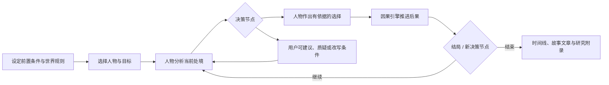

# 故事推演：在选择中观察人物的思想

故事推演让你给出一个**明确前置条件**，再由某一人物视角在连续情境中作出选择，推动事件按合理的因果关系发展。它不是"替历史人物写传记"，而是一种基于其已知方法、价值取向和局限的互动思想实验。

你可以旁观，也可以在关键节点介入。每次选择都会成为可回溯的分支；到达结局时，系统将本次路径整理成一篇完整文章。

## 体验流程



最小界面：人物卡、前置条件输入、`开始推演`、`继续`、`暂停`、`在此介入`、`查看分支`、`结束并写成文章`。

## 四个角色，不能混为一谈

| 角色 | 责任 | 不该做什么 |
| --- | --- | --- |
| 人物视角 | 判断目标、重视什么、会问什么、可能选择什么 | 全知地控制世界或违背其既有材料 |
| 叙事/因果引擎 | 根据世界规则和行动生成合乎逻辑的后果 | 为了剧情方便让事件无因发生 |
| 主持器 | 保持节奏、提示决策点、记录状态 | 替人物强行决定或预设结局 |
| 用户 | 旁观、插话、添加条件、在许可时改写分支 | 把改写后的历史当真实事实 |

## 输入应该足够具体

不要只写"让孔子穿越到现代会怎样"。更适合的开始方式是：

> 2026 年，一所资源有限的中学发生严重的同学排挤。校长邀请孔子视角担任一个月的教育顾问；他不能使用超出材料覆盖范围的现代专业知识，只能向教师、学生和家长提问并提出建议。目标不是迅速给出惩罚，而是让班级恢复可持续的互信。

这个设定交代了时间、地点、角色权限、信息边界和成功标准，因果推演才有抓手。

## 每个决策节点的生成协议

1. 叙事引擎先描述新事实及其原因，不替人物下结论。
2. 人物视角说明自己注意到的冲突，提出必要追问。
3. 给出 2--4 个**其材料可能支持**的行动方向；若人物主动选择，也说清选择理由。
4. 将选择写入状态：目标、资源、关系、风险、未解问题和依据。
5. 因果引擎只根据前置条件、既有状态与选择推进可预见后果，同时保留偶然性和不确定性。
6. 用户点击继续、插话、暂停或在明确标记的节点改变条件。

前台以自然叙事呈现；后台将该回合标为 `direct`（有直接材料）、`inference`（框架推演）或 `simulation`（虚构事件回应）。

## 结局后的三份输出

1. **`timeline.md`：** 所有状态变化与因果链，便于回看或从节点重开分支。
2. **`story.md`：** 沿本次实际选择路径写成一篇完整的故事文章。文章开头说明它是人物视角模拟，不把模拟台词放进引号伪装原话。
3. **`provenance.md`：** 关键选择对应的材料、推演程度、反例和人物资料盲区；默认隐藏，按需查看。

## 质量规则

- 人物不等于万能主角：他/她会受权限、信息、资源、其他人的自主性和错误判断限制。
- 因果不是单线胜利：每个决定都要有成本、延迟效应、他人反应或未预见后果。
- 不让思想标签替代人物：不能把某人每次都写成重复同一句理论口号。
- 历史人物不会自动拥有现代事实和工具；现代背景知识须由前置条件或中立事实简报显式提供。
- 结局不是评价人物"对/错"的唯一标准，要保留可比较的替代分支与未决张力。

## 最小版本

### 已实现：本地状态与分支（M7.1）

```powershell
python 故事推演/scripts/story.py create --config 故事推演/_template/scenario.example.json --preview
python 故事推演/scripts/story.py status --session <ST会话编号>
python 故事推演/scripts/story.py actor --session <ST会话编号>
```

目前只支持历史公共人物的显式草稿预览，不改变人物能力或发布状态。配置中的 premise/rules/goal 是主角已知设定；保密的虚构世界事实放 facts 且 known=false，不要写进主角已知设定。

状态工具提供 propose → choose → effect 三个操作，每个变更须传当前 `--version`，选择时传从零开始的 `--index`，提案和后果通过 `--payload` JSON 文件导入。提案含 situation 与 2—4 个 options，每项含 label/reason/cost/tradeoff；cost 为资源名到非负整数的映射，至少一项为正且不能超支。后果含 observation/cause/resource_delta/reveal/new_facts，观察供人物读取，因果内部说明不进入人物上下文。新事实含 text 和 known，编号由程序生成。

每次选择先扣除代价，再单独提交后果；三次后果后进入 ended。pause/resume 使旧版本请求失效；fork --snapshot <先前操作返回的快照哈希> 可从选择之前的 ready/choosing 状态分出新路径。分支资源、知识和历史来自该快照，不继承主线后来的结果。所有会话保存在忽略目录 sessions/，不提交生成内容。

M7.1 的 6 项原创合成场景测试通过，覆盖成本、三次结局、信息隔离、分支恢复、暂停迟到拒收和损坏快照。人物效果及真实因果合理性仍待验。

### 已实现：分开的角色与后果模型（M7.2a）

```powershell
python 故事推演/scripts/story_runner.py --session <ST会话编号> --model <本机已安装模型名> --confirm-local-service
```

ready 状态时请求人物提出选择；使用状态工具 choose 后，在 awaiting_effect 状态再次运行同一命令，因果引擎推进后果。指定 `--branch` 可在替代路径运行。每步只请求一次，没有自动选择或重试。

人物请求只接人物方法、角色已知情境和最多六张相关已审证据卡；因果请求读取世界状态及所选行动，不加载人物方法文件。每个选择的证据编号须实际加载，来源由程序回链，始终保留 simulation 标记；模型身份记录进分支快照。
同分支生成锁避免重复请求；暂停/恢复改变版本后旧结果拒收。错误保留原状态，可显式重试。崩溃遗留分支目录 `.lock` 时，先确认没有相关生成进程，再清理该锁。

结构隔离只保证未显式提供隐藏字段，不能保证模型生成的观察绝无推断泄漏或因果失真；这些仍需独立内容检查。12 项故事状态/模型测试通过，使用原创模型桩。

### 已实现：实际路径输出（M7.3a）

```powershell
python 故事推演/scripts/story_render.py --session <ST会话编号> --branch main
```

三次后果完成并进入 ended 后，生成 timeline.md、story.md、provenance.md，保存到分支 result-current.json 指向的目录。正文为按实际选择和观察整理的时间顺序草稿，不调用模型补写新事件或额外结局；可使用下方本机叙事编辑命令生成独立版本。因果内部说明只进入时间线，正文不直接读取隐藏世界事实。

每个分支单独绑定源快照。重复渲染不会改变已有相同结果；发现文件被手工修改时拒绝覆盖，保留该文件供检查。15 项故事测试通过（新增 3 项输出测试），涵盖主线/替代路径隔离和未完成拒绝输出。故事工作台已通过本地应用 `/story` 接入设定、选择、后果、分支和三份输出。两个题材的真实质量验收仍待进行。

先做一个人物、一条主线、3 个决策节点和一个结局。每个节点都先保存状态，再由用户点击继续。确认选择—后果链有说服力后，再加入分支树、可视化时间线、多人物共同决策和不同结局的比较。

人物选择器只加载 `manifest.json` 中达到 `simulation-ready` 或 `publish-ready`，且 `capabilities.story_simulation` 为 `true` 的人物。故事比普通聊天需要更多真实决策案例和反例，因此不能只凭人物卡或语言风格开启该能力。

### 本机叙事编辑（M7.3c1）

```powershell
python 故事推演/scripts/story_editor.py --session <ST会话编号> --branch main --model <本机模型名> --confirm-local-service
```

三次决策结束后，可单独请求本机模型将实际路径整理成自然叙事。输入只含已选行动、理由、代价、取舍和可见后果，排除未选分支、隐藏世界事实与内部因果。每段绑定一个决策编号，按顺序覆盖全部三次决策；引用依据由程序从原选择回链。

输出保存到独立 editions 目录及分支 edition-current.json，不覆盖原时间顺序草稿。已有叙事版时拒绝再次生成；失败不发布新指针，可明确重试。CLI 和故事工作台均可调用；路径结束后点击“生成叙事编辑稿”，完成后可查看或下载叙事正文与段落依据。22 项故事测试通过，新增 4 项编辑测试。结构检查不能证明模型没有补写事实，真实文学性和路径忠实度仍需人工审核。
